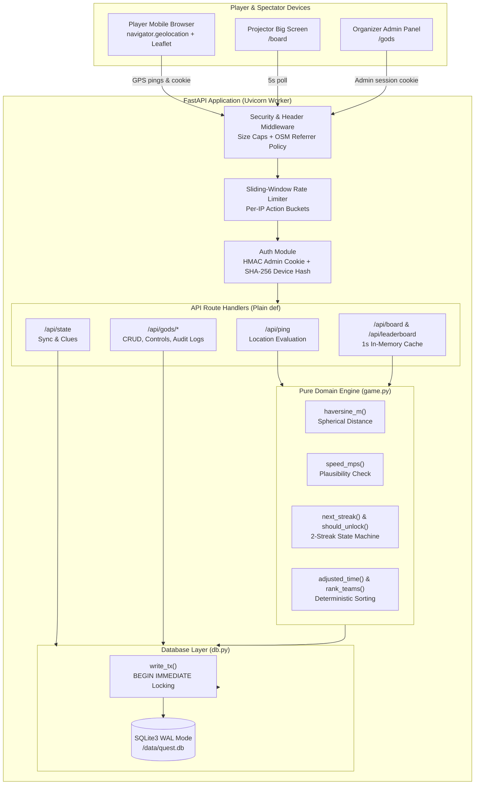

# Campus Quest 📍

> **Geofenced Clue Hunt for the DAVV Takshashila Campus**  
> Built for Google Developer Groups on Campus (GDGoC Indore) Technical Vertical Recruitment — **Task 3**.

[](#running-tests)
[](https://www.python.org/)
[](https://fastapi.tiangolo.com/)
[](https://www.sqlite.org/)
[](https://leafletjs.com/)

---

## Submission Links

- **Live Prototype**: `[https://campus-quest.up.railway.app](https://campus-quest.up.railway.app)` *(replace with active deployment link)*
- **Demo Video Walkthrough**: `[https://youtu.be/your-demo-video](https://youtu.be/your-demo-video)` *(replace with video link)*
- **GitHub Repository**: [https://github.com/manalpj/Campus-Quest](https://github.com/manalpj/Campus-Quest)

---

## What It Is

**Campus Quest** is a mobile-first, location-based treasure hunt designed for college orientations (such as freshers' events at DAVV). 

Teams of 2–10 students open the web application on a single smartphone and solve riddles leading to landmark locations across campus. To unlock the next clue, the team must **physically walk** to the spot. The server verifies their presence using real-time GPS coordinates and a mathematical geofence circle.

### Key Highlights
- **Zero App Installation**: Runs directly in mobile browsers using the browser Geolocation API and Leaflet.
- **Server-Decided Progression**: Clients submit raw GPS fixes and button presses; the backend validates distances, streaks, timers, and unlocks.
- **Power-up Mechanics**: Teams earn **Radar** (live distance readout for 60s) and **Radius Boost** (+30% geofence expansion for 120s) by clearing checkpoints, with an optional **Hint** (+3 min time penalty).
- **Stuck-Team Recovery**: Teams stuck on a clue can skip after a 10-minute wait (+10 min penalty), or organizers can force-clear checkpoints from the admin panel.
- **Projector Big Screen**: A dedicated `/board` view displays real-time team standings and quest state for audience viewing.
- **Resilient & Battery-Friendly**: Integrated Screen Wake Lock API, in-app browser warnings, offline reconnect banners, and sliding-window rate limiting.

---

## Walkthrough (Text-Only)

1. **Registration & Pairing**:
   A team registers on one phone at `/` with a team name and member list, agreeing to event privacy and safety terms. The server issues a unique 8-character team code (e.g. `PHX-4821`) and binds the phone via an `HttpOnly` cryptographic device cookie.
2. **Synchronized Launch**:
   The organizer logs into `/gods`, verifies at least 5 checkpoints exist, and clicks **Start Quest**. All player phones count down together across a synchronized 10-second timer based on server clock offsets.
3. **Physical Navigation & Hunting**:
   Teams view their current clue and a full-screen Leaflet map bounded strictly to DAVV campus. Their live location is indicated by an accessible blue dot. Uncleared checkpoint coordinates remain strictly hidden on the server.
4. **Geofenced Unlocking**:
   When a team reaches the target zone (25–100 m radius), their phone sends GPS fixes to `/api/ping`. Once the server confirms 2 consecutive valid fixes inside the radius, the checkpoint unlocks: a historical story popup appears, the next clue is revealed, and an earned power-up is added to their tray.
5. **Tactical Power-ups**:
   - **Hint**: Reveals an easier hint on demand at the cost of a +3 minute penalty added to adjusted time.
   - **Radar**: Earned on odd-numbered clears; displays live distance in metres to the target spot for 60 seconds.
   - **Radius Boost**: Earned on even-numbered clears; expands target geofences by +30% for 120 seconds.
6. **Live Leaderboard & Finish**:
   Leaderboard standings update automatically every 5 seconds. Teams are ranked by:
   $$\text{Checkpoints Cleared (desc)} \longrightarrow \text{Adjusted Time (asc)} \longrightarrow \text{Earliest Last Unlock (asc)}$$
   $$\text{Adjusted Time} = \text{Elapsed Time at Last Unlock} + \text{Penalties} - \text{Bonuses}$$
   When a team clears the final checkpoint, their time is locked, and they receive their final rank.

---

## How It Works: The Ping-to-Unlock Flow

```
1. Phone tracks position via navigator.geolocation and posts lat, lng, and accuracy to /api/ping.
2. Server rejects fixes with accuracy worse than 30 m without modifying the streak (prevents GPS drift unlocks).
3. Server evaluates speed against the previous fix; jumps exceeding 12 m/s reset the streak and log an audit event.
4. Server computes great-circle distance to the team's current target checkpoint using Haversine formula.
5. If distance <= effective radius (base radius + 30% if Boost is active), consecutive inside streak increments.
6. At 2 consecutive inside fixes, server atomically writes progress in SQLite (BEGIN IMMEDIATE) and reveals next clue.
```

---

## Architecture Overview



---

## Key Design Decisions

- **Server-side authority**: The server decides all unlocks, streaks, and state to ensure client devices cannot falsify progress.
- **Plain `def` route handlers**: FastAPI runs plain `def` endpoints on a worker threadpool so blocking standard-library SQLite disk calls never freeze the main async event loop.
- **Hand-crafted Haversine calculation**: Eliminates external geospatial libraries while keeping spatial calculations lightweight, transparent, and easy to explain.
- **Time as the single score currency**: Translates physical speed, hint penalties, and skips into adjusted time so the fastest clean run wins unambiguously.
- **1-second in-memory leaderboard cache**: Collapses high-frequency polling from dozens of competing devices down to at most one database aggregation per second.
- **Atomic `BEGIN IMMEDIATE` transactions**: Acquires SQLite's write lock upfront to prevent concurrent check-then-insert race conditions.
- **Screen Wake Lock API over native app**: Delivers zero-install accessibility for freshers while preventing phones from sleeping and pausing location tracking.
- **HttpOnly device token hashes**: Protects device cookies from XSS theft while storing only irreversible SHA-256 hashes in SQLite.
- **Proportional percentage radius boost**: Scales geofence expansion fairly (+30%) across both tight landmark perimeters and wide open fields.
- **Zero frontend build step**: Pure HTML5, CSS3, and vanilla JavaScript with Leaflet CDN ensures the frontend is editable directly and requires no bundlers.

---

## API Reference

### Public & Static Pages
| Method | Path | Description |
|---|---|---|
| `GET` | `/` | Player application mobile interface |
| `GET` | `/healthz` | Container health check probe (`{"status": "ok"}`) |
| `GET` | `/api/config` | Safe public settings (campus bounds, tile URL, test mode status) |
| `GET` | `/api/rules` | Dynamically generated quest rules, durations, penalties, and FAQ |
| `GET` | `/board` | Projector big-screen leaderboard HTML |
| `GET` | `/api/board` | Sanitized public leaderboard feed (no member names or secret codes) |
| `GET` | `/privacy` | Plain-language data privacy notice |
| `GET` | `/terms` | Physical safety rules and event terms |
| `GET` | `/gods` | Organizer management panel HTML (unlinked from player app) |

### Player & Team Endpoints
| Method | Path | Auth | Description |
|---|---|---|---|
| `POST` | `/api/register` | Rate limited | Register team, create join code, and set `quest_device` cookie |
| `POST` | `/api/join` | Rate limited | Pair phone to team code if device is unbound (409 if already bound) |
| `GET` | `/api/state` | Device cookie | Authoritative team progress, clues, power-up inventory, and server time |
| `POST` | `/api/ping` | Device cookie | Submit GPS fix; handles accuracy gating, speed check, streaks, and unlocks |
| `POST` | `/api/powerup/{type}` | Device cookie | Activate `hint` (+3m penalty), `radar` (60s distance), or `boost` (+30% radius) |
| `POST` | `/api/skip` | Device cookie | Skip active checkpoint after 10m wait (+10m penalty; no power-up awarded) |
| `GET` | `/api/leaderboard` | Public | Full ranked team standings cached with 1s TTL |

### Organizer & Admin Endpoints (`/api/gods/*`)
*All administrative endpoints require an authenticated `quest_admin` session cookie.*

| Method | Path | Description |
|---|---|---|
| `POST` | `/api/gods/login` | Authenticate organizer with constant-time password check and rate limiting |
| `POST` | `/api/gods/logout` | Clear `quest_admin` session cookie |
| `GET` | `/api/gods/me` | Return authenticated admin username |
| `GET` | `/api/gods/game/status` | Overview of game state, registration toggle, and checkpoint readiness |
| `POST` | `/api/gods/registration/open` | Open team registration |
| `POST` | `/api/gods/registration/close` | Close team registration |
| `POST` | `/api/gods/game/start` | Start synchronized countdown (refused if < 5 checkpoints exist) |
| `POST` | `/api/gods/game/end` | Terminate active quest session |
| `POST` | `/api/gods/game/reset` | Reset quest back to `setup` and wipe teams' run progress for Game 2 |
| `POST` | `/api/gods/game/test-mode` | Toggle tap-to-fake location mode (refused if `ALLOW_TEST_MODE=0`) |
| `GET` | `/api/gods/checkpoints` | List all checkpoints ordered by sequence position |
| `POST` | `/api/gods/checkpoints` | Add route checkpoint (locked once game starts) |
| `PUT` | `/api/gods/checkpoints/{id}` | Edit checkpoint (coords/radius/order locked once game starts; text editable) |
| `DELETE` | `/api/gods/checkpoints/{id}` | Delete checkpoint and recompact route positions (locked once running) |
| `GET` | `/api/gods/teams` | List registered teams, device bindings, progress, and idle times |
| `POST` | `/api/gods/teams/{id}/release` | Clear device binding so a replacement phone can pair via team code |
| `POST` | `/api/gods/teams/{id}/adjust` | Add (+) or remove (-) minutes with mandatory logged reason |
| `POST` | `/api/gods/teams/{id}/clear` | Force-clear checkpoint for stuck team (`how='admin'`, no power-up) |
| `DELETE` | `/api/gods/teams/{id}` | Delete team and cascade records |
| `POST` | `/api/gods/teams/reset` | Reset progress for all teams while preserving team registrations |
| `POST` | `/api/gods/teams/{id}/reset` | Reset progress for a single team |
| `GET` | `/api/gods/events` | Audit event log feed (paged, newest first) |
| `POST` | `/api/gods/wipe` | Purge all teams, hints, progress, and logs (requires typing `WIPE`) |

---

## Setup & Running Locally

### 1. Prerequisites
- Python 3.10 or newer
- Git

### 2. Clone and Setup Environment
```bash
# Clone repository
git clone https://github.com/manalpj/Campus-Quest.git
cd Campus-Quest

# Create Python virtual environment
python -m venv .venv

# Activate virtual environment
# Windows (PowerShell):
.venv\Scripts\Activate.ps1
# Linux / macOS:
source .venv/bin/activate

# Install dependencies
pip install -r requirements.txt -r requirements-dev.txt
```

### 3. Environment Configuration
Copy `.env.example` to create your local `.env`:
```bash
# Windows:
copy .env.example .env
# Linux / macOS:
cp .env.example .env
```

Key configuration variables in `.env`:
- `ADMIN_PASS`: Passphrase for organizer login at `/gods` (minimum 8 characters).
- `SECRET_KEY`: High-entropy key used for HMAC session signatures.
- `ALLOW_TEST_MODE`: Set to `1` to enable map-click GPS simulation for testing and demos.
- `CAMPUS_BOUNDS_*`: Geographic bounding box restricting Leaflet map views.

### 4. (Optional) Seed Sample Checkpoints
Populate 6 sample DAVV campus checkpoints for development:
```bash
python seed.py
```
*(Refuses to run if `ENV=production`.)*

### 5. Run the Server
```bash
uvicorn main:app --reload --port 8000
```

Open your browser:
- **Player Interface**: [http://localhost:8000/](http://localhost:8000/)
- **Organizer Admin**: [http://localhost:8000/gods](http://localhost:8000/gods)
- **Big Screen Board**: [http://localhost:8000/board](http://localhost:8000/board)
- **Interactive API Docs**: [http://localhost:8000/docs](http://localhost:8000/docs)

---

## Running Tests

The test suite contains **168 automated tests** covering pure domain calculations, concurrency locks, security, input validation, and API contracts.

Run the entire suite with `pytest`:
```bash
pytest
```

For verbose output with execution timing:
```bash
pytest -v --durations=10
```

---

## Deployment Notes (Railway)

Campus Quest is configured for 1-click cloud deployment on platforms like [Railway](https://railway.app):

1. **Procfile**: Launch command specified as:
   ```text
   web: uvicorn main:app --host 0.0.0.0 --port $PORT
   ```
2. **Persistent Volume**: SQLite requires a persistent disk across redeployments. Mount a volume at `/data` in Railway and configure:
   ```env
   DB_PATH=/data/quest.db
   ```
3. **Proxy Headers (`FORWARDED_ALLOW_IPS=*`)**: In production behind Railway's load balancer, Uvicorn must trust proxy headers so sliding-window rate limiters capture the actual player IP rather than the proxy router.
4. **HTTPS Enforcement**: The W3C Geolocation API (`navigator.geolocation`) strictly requires a secure context (HTTPS) on mobile devices. Railway automatically provides HTTPS endpoints.

For step-by-step instructions, see [`docs/DEPLOY.md`](docs/DEPLOY.md).

---

## Honest Limitations

We state these limitations plainly:

1. **No background location tracking**: Mobile web browsers pause Geolocation timers when the screen turns off or the tab is switched to conserve battery. Players must keep their screen on while walking. The app integrates the Screen Wake Lock API to prevent sleep, but battery-saver modes can still interrupt it.
2. **GPS accuracy and multipath noise**: Satellite signals drift by 10–25 metres around dense campus trees and concrete buildings. Software can filter weak readings (accuracy > 30 m) and require consecutive hits (2 in a row), but cannot eliminate natural satellite drift.
3. **One device means one browser token**: Websites cannot access hardware IMEI or MAC addresses. "One device per team" is enforced via an `HttpOnly` cryptographic cookie token hash. Clearing cookies allows re-pairing via the team code.
4. **Outdoor ground-level only**: Consumer GPS chips do not provide reliable vertical altitude readings. The server cannot verify whether a team is on the ground floor or the third floor, so checkpoints must remain outdoors.
5. **The server cannot verify that a GPS fix is genuine**: A determined player using external GPS mocking apps or browser DevTools Sensors can transmit arbitrary coordinates over HTTP. The server mitigates this via speed plausibility checks (capping velocity at 12 m/s), accuracy filters, hidden coordinates, and on-site organizers. Physical proofs (such as on-site QR codes or answer phrases) would be required for complete spoof prevention.
6. **Same route sequence for everyone**: All teams follow checkpoints in identical order (1..N), which can cause crowding at early spots during large events. A balanced route group system (assigning teams round-robin to normal or reversed routes) is planned as a future improvement.