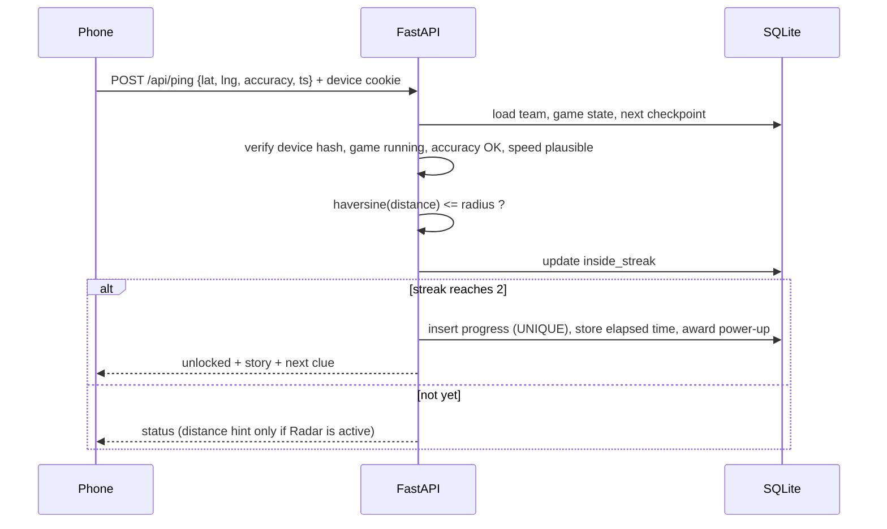

# Campus Quest: Geofenced Clue Hunt
### Complete project document: task, goal, features, workings, architecture, tools and tech stack

> **Context:** GDGoC Indore (Google Developer Group on Campus) recruitment, Technical vertical, **Task 3**.
> **Status:** Planning complete. Build starts next.
> **Revision (9 Oct 2026):** Updated after a review. Changes: build tiers (power-ups moved into the core, golden checkpoint and freeze moved to Bonus), earned power-ups, stuck-team recovery, honest anti-cheat wording, a stricter accuracy rule, a corrected concurrency explanation, a corrected load estimate, and event-day and hosting risks.

---

## Table of contents

1. [The task as given in the document](#1-the-task-as-given-in-the-document)
2. [Our goal, explained clearly](#2-our-goal-explained-clearly)
3. [Feature list, fully explained](#3-feature-list-fully-explained)
4. [How everything works](#4-how-everything-works)
5. [System architecture](#5-system-architecture)
6. [Tools that can be used](#6-tools-that-can-be-used)
7. [Whole tech stack and the use of each part](#7-whole-tech-stack-and-the-use-of-each-part)
8. [Other important things](#8-other-important-things)

---

## 1. The task as given in the document

### 1.1 About the vertical

**Vertical: Technical.**

- Manages the technical systems that support GDGoC's events and online processes.
- Handles ticketing, automation, certificates, website updates and technical maintenance.
- Builds internal tools when required to support other verticals.
- Provides technical support to keep events and digital processes running smoothly.

### 1.2 Task 3: Campus Quest: Geofenced Clue Hunt

> Build a location-based game for the DAVV campus. Players use their phones to move between real campus locations, unlock clues when they enter a checkpoint's zone, and collect power-ups that change how the game plays. It must be usable for a real event such as a freshers' orientation.

**Core tasks listed in the document**

| # | Requirement |
|---|---|
| 1 | A web app or PWA using the browser Geolocation API, with a map of the campus. |
| 2 | At least 5 checkpoints with geofences, so a clue unlocks only when the player is inside the zone. |
| 3 | A clue and power-up system (for example: a hint reveal, a radius boost, a time bonus) with clear rules. |
| 4 | Teams or individual players with a live leaderboard. |
| 5 | Admin controls for an organizer to add or edit checkpoints. |

**Guidance in the document:** *"A solid, working basic solution that you fully understand beats an overhyped advanced one you can't explain."*

### 1.3 What to submit

- Your **GitHub repository link**
- A **video link** of your working prototype
- The **prototype link** (if deployed)

**Submission guidelines**

- **File name:** `YourName_TechnicalTask2026`
- **Format:** PDF / Docs file
- **Include:** GitHub repository link, prototype video link, and prototype link (if deployed). All links must open for anyone with the link.
- **Upload via:** the Google Form link shared in the mail.

### 1.4 Extra information from the briefing meeting

- Only **one task** has to be done.
- Applicants are freshers, so **AI-assisted ("vibe") coding is allowed** for the whole project.
- What matters is that the applicant **understands what is happening and how**: how the logic works, how the algorithm is set up, and how the code is written.
- A **half-finished project that the applicant fully understands** can still get a chance.
- An **interview round comes later (after 20 October)**, where questions will be about the logic behind the system, for example: *"How does the system know a player moved from here to there?"*

---

## 2. Our goal, explained clearly

### 2.1 In simple words

Campus Quest is a **treasure hunt played on phones across the real campus**. Think of it like Pokémon GO for freshers' orientation.

Teams open a website on one phone. Hidden checkpoints are placed at real outdoor spots. A team must **physically walk** to a spot. When the server confirms the team is inside the spot's circle, the clue for the next spot appears. The team that clears all checkpoints in the **lowest adjusted time** wins.

### 2.2 An example round

1. Team Phoenix registers on one phone and receives a team code.
2. The organizer presses **Start**. The first clue appears: *"Find the tree the locals call the Babool Ka Ped."*
3. The team walks. The blue dot on the map moves with them. The checkpoint stays hidden.
4. They enter the checkpoint's 30 m circle. After two consecutive confirmations, the checkpoint unlocks, a short story about the place appears, and the next clue is shown.
5. Each cleared checkpoint also awards one power-up. Stuck on a clue, they use a **Hint** (+3 minutes on their time, always available) or a **Radar** they have earned (shows distance to the next spot for 60 seconds). If a team is badly stuck, it can **Skip** the checkpoint for a time penalty, or an organizer can clear it for them.
6. *(Bonus feature)* The organizer activates a **Golden Checkpoint** for 10 minutes. The first few teams to reach it get −2 minutes and a free power-up.
7. The leaderboard updates every 5 seconds. *(Bonus feature)* In the final minutes, the organizer **freezes** it so the result stays a surprise.
8. A team clears all checkpoints and sees its final time. The organizer ends the game and the final board is revealed.

### 2.3 What we are building (the three pages)

| Page | URL | Who uses it | Purpose |
|---|---|---|---|
| Player app | `/` | Teams | Register, play, see the leaderboard |
| Admin panel | `/gods` | Organizers | Run and configure the event |
| Big screen | `/board` | Projector at the event | Read-only live leaderboard |

### 2.4 Design goals

1. **Usable at a real event.** About 70 teams, patchy campus signal, organizers on site.
2. **Explainable end to end.** Every rule has a one-sentence reason.
3. **Server decides everything.** The phone is untrusted. It only reports where it is. The server still cannot prove that a reported position is genuine (see section 4.2), so the design limits cheating rather than claiming to remove it.
4. **Fair and simple.** Same checkpoints, same order for everyone. Time is the only score.
5. **Encourages teamwork.** One phone per team forces teammates to discuss and move together.
6. **Small and finishable.** We cut anything that adds risk without adding understanding.

### 2.5 Key decisions already made

| Topic | Decision | Why |
|---|---|---|
| Platform | Mobile-first **website** (PWA optional) | No install, one codebase, matches the brief |
| Checkpoints | **Start empty. Admin adds them.** Same list, same order for all teams | Simple, no route balancing needed |
| Visibility | Hidden until cleared (golden checkpoint shows while live) | Keeps the mystery |
| Location of checkpoints | **Outdoor, ground level only** | GPS cannot verify floors |
| Scoring | **Time is the only currency** | Fastest clean run wins, no point/speed conflicts |
| Ranking | Most checkpoints cleared, then lowest adjusted time | Works mid-game and at the end |
| Device rule | **One phone per team**, organizer releases a lost device | Forces collaboration, simple to explain |
| Admin URL | `/gods`, with user ID + password | Separate from player URL |
| Database | **SQLite**, written by us | Full control and easy to explain |
| Hosting | **Railway**, with a persistent volume | HTTPS and persistent storage |
| Leaderboard updates | **Polling** every 5 s | Simple and enough at this scale |
| Power-ups | **Earned:** one per cleared checkpoint, alternating Radar and Radius boost. Hint is always available for a time penalty | The brief says players "collect" power-ups, and this needs no extra checkpoint type |
| Stuck teams | Player **Skip** after a wait (time penalty), or organizer **force-clear** | A real event cannot leave a team stuck forever |
| Build tiers | Must / Should / Bonus (section 8.6). Golden checkpoint and freeze are **Bonus** | The brief rewards a basic solution you fully understand |

---

## 3. Feature list, fully explained

Each feature is tagged with its build tier from section 8.6: **Must have**, **Should have** or **Bonus**.

### 3.1 Player app (`/`)

#### F1. Team registration *(Must have)*
- The player enters a **team name** and **member names** (minimum 2, configurable).
- The server creates the team, a short **team code** (for example `PHX-4821`) and a random **device token** (see F2).
- Registration works only while the organizer has it open.
- If the game has already started, late registration is the organizer's choice. A late team's clock still counts from game start.

#### F2. One device per team *(Must have; Release device is Should have)*
- The server sets the device token as an **HttpOnly, Secure, SameSite=Lax cookie** in the registration response, so page JavaScript never reads it. The server stores only its **hash**.
- Every request carries the token. If it does not match the stored hash, the server rejects it.
- If another phone enters the team code while a device is bound, it sees: *"This team is already playing on another device."*
- Entering a team code (`/api/join`) is **rate limited per IP** (generous, for example 20 tries a minute, because many students share campus Wi-Fi), so team codes cannot be guessed by brute force.
- **If a phone dies or breaks:** the team goes to an organizer, who presses **Release device** in `/gods`. This clears the stored hash. The next phone to enter the team code becomes the team's device, and the old phone is locked out. The release is recorded in the event log.
- **Honest limit:** a website cannot read a hardware ID, so "one device" means "one browser token". Registering a duplicate team is the realistic workaround, and the organizer can spot and delete duplicates in the teams list.

#### F3. Lobby (before the game starts) *(Must have)*
- Shows team name, members, team code and the rules.
- Shows "Waiting for the organizer to start". When the organizer starts the game, the next poll shows a countdown and then the game screen.

#### F4. Game screen *(Must have)*
- **Map:** Leaflet + OpenStreetMap, restricted to campus bounds.
- **Live position:** the player's dot with an accuracy ring (see F13 for the 3D look).
- **Hidden checkpoints:** nothing shows until cleared. Cleared ones appear with a tick. A live golden checkpoint also appears.
- **Clue card:** the clue for the team's next checkpoint.
- **Status bar:** cleared count (for example 2/5), adjusted time, GPS quality indicator.
- **Power-up tray:** Hint, Radar and Radius boost, each with a count and timer.
- **Skip button:** appears on the clue card only after the wait time described in F15.
- **Tabs:** Map, Leaderboard, Team, Rules.

#### F5. Geofenced unlock (the core feature) *(Must have)*
- The phone sends a location fix every ~4 seconds.
- The server rejects bad-accuracy fixes, measures the distance to the team's next checkpoint, and unlocks it only after **two consecutive inside fixes**.
- Full detail is in [section 4.2](#42-how-movement-and-unlock-detection-works).

#### F6. Clues *(Must have)*
- Each checkpoint has one **clue** that describes where it is.
- A team always sees the clue for its **next uncleared checkpoint**, which is the lowest order number it has not yet cleared.
- After unlocking, the team sees the checkpoint's optional **story** (a one-line fact about the place) and then the next clue.

#### F7. Power-ups *(Must have: Hint and Radar. Should have: Radius boost)*

| Power-up | Effect | Cost or limit | How a team gets it |
|---|---|---|---|
| **Hint** | Shows an easier second clue for the current checkpoint | **+3 min** on the team's time, max 1 per checkpoint | Always available |
| **Radar** | Shows live distance to the next checkpoint for **60 s** | One use each | **Earned:** awarded for clearing an odd-numbered checkpoint (1st, 3rd, ...). The golden checkpoint (Bonus) can give more |
| **Radius boost** | Increases the geofence radius by **+20 m for 2 min** | One use each | **Earned:** awarded for clearing an even-numbered checkpoint (2nd, 4th, ...). The golden checkpoint (Bonus) can give more |

- Pressing a button calls the server. The server checks the team owns one, applies the effect and deducts it.
- **Earning rule:** teams start with no Radar or Radius boost. Clearing a checkpoint awards exactly one, alternating Radar then Radius boost. A skipped or force-cleared checkpoint awards nothing. Until Radius boost is built, every award is a Radar.
- All numbers live in the `config.py` defaults (editable in the admin config editor, a Bonus feature), and the **Rules tab reads from the same config**, so the text can never go out of date.
- **Radar example:** next spot is Backstage and the clue is vague. The team uses Radar. For 60 seconds a box shows `240 m → 180 m → 90 m → 30 m → "You're very close!"`. If the number grows, they are walking the wrong way.

#### F8. Golden checkpoint (organizer-triggered bonus) *(Bonus)*

*Deferred to the Bonus tier: it adds a second geofence check to the ping path, a banner system and a claims table, so build it only after everything in Must have and Should have works and is explained.*
- The organizer activates it manually with a chosen **duration** (for example 10 min) and **max claims** (for example first 5 teams).
- Every phone shows a banner with a countdown, and the spot appears on the map.
- A team that reaches it (same geofence rules) gets **−2 min** and **+1 power-up** (Radar or Radius boost).
- The claim runs inside **one `BEGIN IMMEDIATE` transaction** that checks the window, counts the claims and inserts the claim. A `UNIQUE(golden_id, team_id)` rule separately stops one team claiming twice. See section 4.7.
- It closes when time or slots run out, or when the organizer closes it.
- It is **not part of the normal order**. It is a surprise bonus.

#### F9. Leaderboard *(Must have; frozen mode is Bonus)*
- Polls every 5 seconds. Shows **rank, team, cleared/total, adjusted time**. The server computes the ranking at most once per second and caches it (sections 4.6 and 5.7).
- *(Bonus)* **Frozen mode:** when the organizer freezes the board, everyone sees the last saved snapshot with a "Frozen" banner. A team's own game screen still shows its true progress.
- Ending the game **unfreezes** the board so the final result is visible.

#### F10. Team tab *(Must have; navigator rotation is Bonus)*
- Members, team code and device status ("This phone is your team's device").
- If the phone is lost, a message says to ask an organizer to release the device.
- **Optional navigator rotation** *(Bonus)*: suggests who holds the phone next after each checkpoint. It cannot be enforced, but it nudges collaboration (about 10 lines of code).

#### F11. Finish screen *(Must have)*
- After the last checkpoint: final adjusted time, plus rank (hidden while the board is frozen).

#### F12. Reliability features *(Should have)*
- **Wake Lock API** keeps the screen on, because a page stops sending location when the screen locks. If unsupported, a "keep this screen on" message shows.
- **Resume anywhere:** all state is on the server, so reloading the page continues exactly where the team was.
- **Clear error states:** location permission denied, no GPS, weak GPS, offline, game not started, game ended.
- **Honest limit:** a web page cannot track location in the background or on a locked screen.

#### F13. Fake-3D blue dot *(Bonus)*
- A custom Leaflet marker built from HTML/CSS: a glossy gradient sphere, a pulsing accuracy ring, and an optional direction cone from the compass heading.
- It looks 3D and costs about 15 minutes. A true 3D model (MapLibre + Three.js) is possible but would take 2-3 hours and add risk, so it stays optional.

#### F14. Checkpoint stories *(Bonus)*
- A one-line fact shown after a checkpoint is cleared, for example about the building or tree. It makes the event feel real and costs one extra text field.

#### F15. Stuck-team recovery: Skip and force-clear *(Should have)*
A real event cannot leave a team stuck forever. GPS may never confirm a spot, a landmark may be blocked, or a clue may simply be too hard. There are two ways out:
- **Player Skip:** the Skip button on the clue card unlocks only after the team has spent a minimum time on that checkpoint (default 10 min). Pressing it costs a **+10 min** penalty, counts the checkpoint as passed and moves the team to the next clue. A skipped checkpoint awards no power-up and shows no story.
- **Admin force-clear:** in `/gods`, an organizer can clear the current checkpoint for a team (for example when the spot is blocked or GPS fails there). By default there is no penalty, because it is not the team's fault, and the organizer can add minutes separately. The action and its reason are logged.
- Both write a `progress` row with `how = skipped` or `how = admin`, so the results show exactly how each checkpoint was passed.
- The wait time and the penalty live in config.

### 3.2 Admin panel (`/gods`)

**Access:** user ID + password. Credentials are stored as **environment variables** on the host, never in the repository. The server compares them in constant time and sets a **signed, HttpOnly cookie**. Login attempts are rate limited per IP. `/gods` is not linked from the player app.

| Section | What it does | How it works |
|---|---|---|
| **Game control** *(Freeze/Unfreeze: Bonus)* | Open/close registration, **Start**, **End**, **Freeze/Unfreeze** | A `game_state` setting plus flags. Freeze stores a leaderboard snapshot. **Start stays disabled until at least N checkpoints exist** (default 5). |
| **Checkpoints** | Add, edit, move, reorder, delete | **The list starts empty.** Click the map to drop a pin, then set name, radius, clue, hint, story and order number. Drag a pin to move it. |
| **Golden checkpoint** *(Bonus)* | Create and activate/deactivate | Choose a spot, duration and max claims. Activate now. Close early if needed. |
| **Teams** | See and manage every team | Name, members, device status, last seen, progress and time. Actions: **Release device**, **Force-clear current checkpoint** (logged reason, see F15), add or remove minutes (with a logged reason), delete team. |
| **Config** *(editor is Bonus)* | Tune the rules | Defaults live in `config.py`. The admin editor covers: hint penalty, skip penalty and wait time, golden bonus, boost size and duration, radar duration, accuracy limit (default 30 m), maximum speed (default 12 m/s), minimum members, minimum checkpoints. |
| **Test mode** *(Should have)* | Tap the map to fake your location | Off by default. The tap-to-fake feature is refused unless test mode is on, so it cannot be used in the real event. It does not detect spoofing done outside the app (see section 4.2). |
| **Event log** *(Logging: Should have. Viewer tab: Bonus)* | Every important action | Unlocks, skips, power-up uses, device releases, admin actions. Written by a small `log_event()` helper into the `events` table. Useful for disputes and for the demo video. |
| **Export** *(Bonus)* | Download results | Teams and standings as JSON/CSV before the event ends. |

**Locking rule:** after the game starts, checkpoint **locations, radii and order are locked**. Only the clue, hint and story text can still be edited.

### 3.3 Big-screen leaderboard (`/board`) *(Should have)*
- Read-only page with large text for a projector.
- Refreshes every 5 seconds and respects the freeze.
- About 30 lines on top of the leaderboard endpoint.

### 3.4 Ranking and time rules

- **Rank by:** (1) most checkpoints cleared, (2) lowest adjusted time, (3) earlier last unlock. A skipped or force-cleared checkpoint counts as cleared, and the skip penalty is what makes skipping costly.
- **Adjusted time** = time since game start at the team's last unlock + hint penalties + skip penalties + admin penalties − golden bonuses.

| Event | Effect on time |
|---|---|
| Use a hint | +3 min |
| Skip a checkpoint | +10 min (default) |
| Claim golden checkpoint | −2 min |
| Admin correction or penalty | Any amount, with a logged reason |
| Radar, radius boost | None (they are earned, limited-use helpers) |

**Why time is the only currency:** with points plus speed, a team could finish fast and clean but lose to a slower team that collected extra bonuses. With a single currency, the best run wins and power-ups still matter because they move your time.

---

## 4. How everything works

### 4.1 A game from start to finish

```
Organizer (/gods)                     Server                          Teams (/)
-----------------                     ------                          ---------
Add checkpoints on map  ───────────►  saves in SQLite
Open registration       ───────────►  flag set                ◄──────  Register team (device bound)
Press Start (needs ≥5)  ───────────►  game_state = running    ──────►  Lobby becomes countdown, game
                                      records start time
                                      ◄──── location fixes every ~4 s ◄─ phone sends position
                                      checks distance, streak, accuracy
                                      unlocks checkpoint, stores time ─► clue + story shown
                                      awards one power-up   ──────►  power-up added to the tray
Activate golden         ───────────►  golden window opens     ──────►  banner, spot appears   (Bonus)
Freeze leaderboard      ───────────►  snapshot saved          ──────►  frozen board   (Bonus)
Press End               ───────────►  game_state = ended      ──────►  final results shown
```

### 4.2 How movement and unlock detection works

This is the central question the interview is likely to ask: *"How does the system know a player moved from here to there?"*

1. **The phone produces position fixes.** The browser's Geolocation API combines GPS, Wi-Fi and cell data into `latitude`, `longitude`, `accuracy` and a `timestamp`. `watchPosition()` fires whenever a new fix arrives.
2. **The app never sees "movement", only points.** Movement is inferred by comparing consecutive fixes.
3. **The client sends the latest fix to `/api/ping` about every 4 seconds.**
4. **Accuracy check:** if `accuracy` is worse than the limit (default **30 m**, to be tuned during the on-campus walk), the server ignores the fix and the phone shows "GPS weak, move to an open area". *Why 30 m and not more:* the zones are only 25-40 m wide, so a fix whose own error is 50 m says almost nothing about whether the player is inside. The limit is a trade-off: too loose and a player can unlock from outside the zone, too strict and a team standing inside the zone is never confirmed (which is what Skip and force-clear are for).
5. **Distance:** the server computes the great-circle distance between the fix and the team's next checkpoint using the **Haversine formula**.
6. **Inside test:** the fix is "inside" if `distance ≤ radius` (plus the boost, if active).
7. **Streak:** the team's `inside_streak` goes up by 1 on an inside fix and resets to 0 on an outside fix. The checkpoint unlocks only when the streak reaches **2**. This filters out one-off GPS jumps.
8. **Unlock:** the server writes a `progress` row (with elapsed time), resets the streak, awards one power-up (alternating Radar and Radius boost), and returns the story and the next clue.
9. **Speed plausibility (Should have):** speed = distance between consecutive fixes ÷ time between them (using the server's receive times). A speed above the limit (default 12 m/s, about 43 km/h, faster than a bicycle on campus) rejects the fix, resets the streak and is logged. A long gap followed by a legitimate jump, such as a phone that lost signal for a few minutes, gives a low speed and is accepted.

**The client never says "I unlocked it".** It only says where it is, and the server decides what that means. That stops the simplest cheat (calling an unlock endpoint), but it does **not** make the game cheat-proof: the server cannot tell a real GPS fix from a fake one. A player using a location-spoofing app, Chrome DevTools Sensors or a hand-made request can send any coordinates and any `accuracy` value. What the server does is limit the damage: the speed check rejects teleporting, the accuracy rule rejects vague fixes, checkpoints stay hidden, and organizers are on site. The real fix is a proof that needs physical presence, such as a QR code or answer code at each checkpoint (section 8.9).

**Haversine in plain form**

```
a = sin²(Δlat / 2) + cos(lat1) · cos(lat2) · sin²(Δlng / 2)
distance = 2 · R · asin(√a)          where R = 6,371,000 m
```

It gives the straight-line distance between two latitude/longitude points on a sphere.

**Why not just compare coordinates directly?** Degrees of latitude and longitude are not equal lengths on the ground, so a simple coordinate difference would give wrong distances. Haversine converts degrees into metres correctly.

### 4.3 Why radius, accuracy and streak all exist

| Problem | What we do |
|---|---|
| GPS drifts 10-50 m, more near big buildings | Radii of 25-40 m, accuracy limit (30 m), two-fix streak, radius boost power-up |
| One bad fix would unlock too early | Two consecutive inside fixes |
| Player fakes their location | The server **cannot verify** GPS, so it limits the damage: speed check, accuracy rule, hidden checkpoints, organizers on site. Admin test mode is off during the event. QR or answer codes are the real fix (section 8.9) |
| Floors cannot be verified | Outdoor ground-level checkpoints only |
| A team cannot unlock a spot (GPS never confirms, spot blocked) | Skip with penalty, or organizer force-clear (F15) |

### 4.4 The one-device flow

1. Team registers → server generates a token → server stores the **hash** → the server sets the token as an HttpOnly cookie on the phone.
2. Each request includes the cookie → server hashes it and compares with the stored hash.
3. A second phone with the team code is refused while a device is bound. Join attempts are rate limited per IP.
4. **Lost phone:** organizer presses **Release device** → hash cleared → the next phone to enter the team code becomes the device, and the old one stops working.

### 4.5 Admin login flow

1. Organizer opens `/gods` and enters user ID and password.
2. Server compares them with the environment variables using a constant-time comparison.
3. On success the server sets a signed `HttpOnly`, `Secure`, `SameSite` cookie.
4. Every `/api/gods/...` request checks this cookie. Failed logins are rate limited.

### 4.6 Leaderboard, freeze and snapshot

- **Live:** the server computes the ranking from `progress` and penalty/bonus values with a sort on `(cleared desc, adjusted_time asc, last_unlock asc)`. The result is cached in memory for 1 second (and cleared on every unlock), so 70 teams polling do not each trigger a full sort.
- **Freeze** *(Bonus)*: the server saves the current ranking into the `snapshot` table and flags the board as frozen. Public endpoints return the snapshot. The admin still sees live scores.
- **Unfreeze or End:** the flag is cleared and the board is live again.

### 4.7 Golden checkpoint claim (concurrency) *(Bonus feature)*

1. Admin activates it with a window and a max number of claims.
2. When a team's fix is inside the golden zone for two fixes, the server opens **one `BEGIN IMMEDIATE` transaction** and, inside it: check the window is open, check slots remain, check the team has not claimed, insert the claim, apply −2 min and +1 power-up.
3. Two different things protect the claim, and it is worth keeping them apart:
   - The **`UNIQUE(golden_id, team_id)`** rule stops **one team** claiming twice.
   - The **`BEGIN IMMEDIATE` transaction** stops **two teams** taking the last slot. It takes SQLite's write lock *before* the claim count is read, so the second team waits, then sees the slot is gone. Python's `sqlite3` module normally begins a transaction only just before an `INSERT` or `UPDATE`, which would leave a gap between "count the claims" and "insert the claim". To avoid that gap the connection runs in autocommit mode (`isolation_level=None`) and we issue `BEGIN IMMEDIATE` ourselves.

### 4.8 Time handling

- **All time comes from the server clock.** Phone clocks are never trusted.
- Elapsed time = server time at unlock − game start time.
- Reloading a page does not reset anything because everything is stored on the server.

---

## 5. System architecture

### 5.1 Overview

```
┌──────────────────────────────┐        HTTPS         ┌──────────────────────────────────────────┐
│          PLAYER PHONE        │ ───────────────────► │              RAILWAY SERVICE             │
│  index.html + app.js         │                      │                                          │
│  Leaflet map (OSM tiles)     │ ◄─────────────────── │   FastAPI app (uvicorn, 1 worker)        │
│  Geolocation API             │     JSON responses   │   ├─ routes: players, gods, board        │
│  Wake Lock API               │                      │   ├─ auth.py   (device token, admin)     │
│  Polls /api/state every 5 s  │                      │   ├─ game.py   (Haversine, unlock,       │
│  Pings /api/ping every 4 s   │                      │   │             ranking, power-ups)      │
└──────────────────────────────┘                      │   ├─ db.py     (all SQL lives here)      │
                                                      │   └─ static files (HTML/JS/CSS)          │
┌──────────────────────────────┐        HTTPS         │                    │                     │
│        ORGANIZER LAPTOP      │ ───────────────────► │                    ▼                     │
│  gods.html (login + panel)   │                      │        SQLite file on a Railway Volume   │
└──────────────────────────────┘                      │        (/data/quest.db, WAL mode)        │
                                                      └──────────────────────────────────────────┘
┌──────────────────────────────┐
│          PROJECTOR           │ ──► /board (read-only leaderboard)
└──────────────────────────────┘

Map tiles load straight from OpenStreetMap to the phone (not through our server).
```

### 5.2 Layers and responsibilities

| Layer | Responsibility | Does not do |
|---|---|---|
| **Frontend (browser)** | Shows map, sends position, renders state | Decide unlocks, score, rank |
| **API (FastAPI)** | Validates requests, enforces rules, returns state | Store state in memory only |
| **Game logic module** | Haversine, unlock, ranking, power-up rules | Touch HTTP or HTML |
| **Database module** | Every SQL statement | Contain game rules |
| **SQLite on volume** | Persistent data | Run on the container's temporary disk |

Keeping the game logic and the database in separate modules makes the rules testable and makes a future move to Postgres small.

**Concurrency note:** SQLite calls block. Write the endpoints as plain `def` functions (FastAPI runs them in a thread pool) instead of `async def`, so one slow query does not freeze every other request. Open one connection per request, keep transactions short, and set `PRAGMA busy_timeout` so a waiting writer retries instead of failing.

### 5.3 Request flow for a location ping



### 5.4 Endpoints

**Player**

| Endpoint | Purpose |
|---|---|
| `POST /api/register` | Create team, return team code and device token |
| `POST /api/join` | Enter a team code (succeeds only if no device is bound). Rate limited per IP |
| `GET /api/state` | Game state, current clue, power-ups, golden banner (polled) |
| `POST /api/ping` | Send a location fix, get unlock result |
| `POST /api/powerup/{type}` | Use hint, radar or boost |
| `POST /api/skip` | Skip the current checkpoint after the wait time, for a time penalty |
| `GET /api/leaderboard` | Live or frozen ranking |

**Admin** (all require the login cookie)

| Endpoint | Purpose |
|---|---|
| `POST /api/gods/login` | Log in with user ID and password |
| `POST/PUT/DELETE /api/gods/checkpoints` | Manage checkpoints |
| `POST /api/gods/game/{start,end,freeze,unfreeze}` | Game control (freeze and unfreeze are Bonus) |
| `POST /api/gods/registration/{open,close}` | Registration control |
| `POST /api/gods/golden/{activate,close}` | Golden checkpoint (Bonus) |
| `POST /api/gods/teams/{id}/release` | Release device |
| `POST /api/gods/teams/{id}/adjust` | Add or remove minutes |
| `POST /api/gods/teams/{id}/clear` | Force-clear the team's current checkpoint (logged reason) |
| `GET /api/gods/teams`, `/events`, `/export` | Monitoring and export (the events viewer and export are Bonus) |
| `PUT /api/gods/config` | Rule values (Bonus; defaults live in `config.py`) |

**Public read-only:** `GET /api/board` for the big screen.

### 5.5 Data model

```
settings    (key, value)                        -- game_state, frozen, registration_open, config values
checkpoints (id, name, lat, lng, radius, position, clue, hint, story,
             kind: route | golden)
teams       (id, name, code, members JSON, device_hash, last_seen,
             penalty_s, bonus_s, radar_left, boost_left, radar_until, boost_until,
             inside_streak, last_fix_lat, last_fix_lng, last_fix_ts, finished_at)
progress    (team_id, checkpoint_id, unlocked_at, elapsed_s, how)    UNIQUE(team_id, checkpoint_id)
hint_uses   (team_id, checkpoint_id)                            UNIQUE(team_id, checkpoint_id)
-- Bonus tier: golden, golden_claims, pings and snapshot
golden      (id, checkpoint_id, opens_at, closes_at, max_claims)
golden_claims (golden_id, team_id, claimed_at)                  UNIQUE(golden_id, team_id)
pings       (team_id, lat, lng, accuracy, ts)                   -- latest per team, for the admin view
events      (id, ts, team_id, type, detail)
snapshot    (json, taken_at)
```

**Important rules enforced by the database**
- `UNIQUE(team_id, checkpoint_id)` on `progress` stops a checkpoint from being scored twice.
- `UNIQUE(golden_id, team_id)` stops a team claiming the golden checkpoint twice. The last-slot race is prevented by the `BEGIN IMMEDIATE` transaction, not by this rule (section 4.7).
- `progress.how` is `unlocked`, `skipped` or `admin`, so results show how each checkpoint was passed.
- `radar_left` and `boost_left` start at 0 and increase by one for each cleared checkpoint (alternating).
- SQLite runs in **WAL mode** for better concurrent reads and writes.

### 5.6 Deployment architecture

| Item | Setup |
|---|---|
| Source | GitHub repository |
| Host | Railway service, deployed from the repo |
| Start command | `uvicorn main:app --host 0.0.0.0 --port $PORT` (one worker) |
| Storage | Railway **Volume** mounted at `/data`, `DB_PATH=/data/quest.db` |
| HTTPS | Generated public domain from Railway (`https://...up.railway.app`) |
| Secrets | `ADMIN_USER`, `ADMIN_PASS`, `SECRET_KEY` as environment variables |
| Uptime | Keep the service running and the volume attached until results are announced. The interview is after 20 October, and reviewers may open the prototype link before or after it. Check that your Railway plan and credits cover this, and keep a local-run fallback |

### 5.7 Scale estimate

300 freshers is about 60-75 teams (one phone each). Taking 70 teams at the busiest moment:

| Traffic | Rate |
|---|---|
| Location pings (every 4 s) | about 17 per second |
| `/api/state` polls (every 5 s) | about 14 per second |
| Leaderboard polls (every 5 s, with the Leaderboard tab open) | up to about 14 per second |
| **Total** | **about 45 requests per second** |

Only the pings write to the database (about 17 small writes a second). The polls only read. SQLite in WAL mode with short transactions handles this comfortably on one small service. Three habits keep it that way: plain `def` endpoints, one connection per request with `busy_timeout`, and a 1-second cache for the leaderboard (section 4.6).

---

## 6. Tools that can be used

*(Not final, only a rough idea. It can change while building.)*

| Purpose | Tool | Use |
|---|---|---|
| Code editor | VS Code | Writing and reading the code |
| AI assistant | Claude | Generating code in small pieces and explaining it |
| Version control | Git + GitHub | Repository for submission and Railway deployment |
| Hosting | Railway | HTTPS hosting with a persistent volume |
| Location testing | Chrome DevTools → Sensors | Fake GPS coordinates on a laptop |
| Real device testing | Phone browser (Chrome/Safari) | Real GPS, accuracy and Wake Lock behaviour |
| Coordinates | Google Maps | Right-click a spot to copy exact latitude and longitude |
| Map reference | OpenStreetMap | Confirm campus labels and paths shown to players |
| API testing | `curl` or Postman | Test endpoints without the UI |
| Database viewing | DB Browser for SQLite | Inspect tables during development |
| Diagrams | Mermaid / draw.io | Architecture diagram for the README |
| Video recording | Phone screen recorder, OBS Studio | Demo video |
| Video hosting | YouTube (unlisted) or Google Drive | Hosting the demo link (set to "anyone with the link") |
| Link checking | Incognito browser window | Confirm every submitted link opens publicly |
| Documents | Google Docs / PDF export | The final submission file |

---

## 7. Whole tech stack and the use of each part

### 7.1 Backend

| Technology | Use in this project |
|---|---|
| **Python 3** | Main language for all server logic |
| **FastAPI** | Web framework. Defines the API endpoints and serves the static pages |
| **Uvicorn** | The server process that runs FastAPI (one worker because of SQLite) |
| **Pydantic** (comes with FastAPI) | Validates request bodies, such as latitude ranges and team names |
| **SQLite** (`sqlite3` module) | Database for settings, checkpoints, teams, progress, events |
| **WAL mode** | SQLite setting that allows reads during writes |
| `math` | Haversine distance calculation |
| `secrets` | Generates device tokens and team codes |
| `hashlib` | Hashes device tokens before storing them |
| `hmac` | Constant-time comparison and signing of admin cookies |
| `time` / `datetime` | Server-side timestamps and elapsed-time maths |
| `json` | Stores member lists and config values |
| `csv` | Optional results export |

### 7.2 Frontend

| Technology | Use in this project |
|---|---|
| **HTML / CSS** | Mobile-first pages for players, admin and board |
| **Vanilla JavaScript** | Rendering state, timers, button handlers, and calling the API |
| **Fetch API** | Talks to the backend (`/api/...`) |
| **Geolocation API** (`watchPosition`) | Gets the phone's latitude, longitude and accuracy |
| **Leaflet.js** | Draws the map, markers, circles and accuracy ring |
| **OpenStreetMap tiles** | Free map imagery. No API key needed |
| **Wake Lock API** | Keeps the screen on during the game |
| **CSS gradients / animation** | The fake-3D blue dot and pulsing ring |
| **Device Orientation API** (optional) | Compass direction cone on the dot |
| **Web App Manifest + service worker** (optional) | "Add to Home Screen" PWA behaviour |

### 7.3 Infrastructure

| Technology | Use in this project |
|---|---|
| **GitHub** | Stores the code and triggers Railway deploys |
| **Railway** | Runs the server and provides an HTTPS domain |
| **Railway Volume** | Keeps the SQLite file safe across restarts and redeploys |
| **Environment variables** | Keep admin credentials and secret keys out of the repository |

### 7.4 Why these choices

| Choice | Reason | Trade-off |
|---|---|---|
| Python + FastAPI | Strongest language for the builder, clean API code | Needs a small amount of JavaScript for the browser parts |
| SQLite over Firebase/Supabase | The server must own validation, and SQLite is easy to explain | Needs a volume for persistence, and one worker only |
| Polling over WebSockets | Simple and enough for 5-second updates | Slightly less instant, and more requests |
| Leaflet + OSM | Free, no key, simple | No satellite imagery by default |
| Website over native app | No install, one codebase, matches the brief | No background tracking |

### 7.5 Suggested project structure

```
campus-quest/
├── main.py            # FastAPI app and route definitions
├── game.py            # Haversine, unlock logic, ranking, power-ups
├── db.py              # Every SQL statement and the schema
├── auth.py            # Device tokens, admin login, cookie signing
├── config.py          # Defaults and environment variable loading
├── seed.py            # Recreates sample checkpoints quickly
├── requirements.txt
├── static/
│   ├── index.html     # Player app
│   ├── gods.html      # Admin panel
│   ├── board.html     # Big-screen leaderboard
│   ├── app.js
│   ├── gods.js
│   └── style.css
└── README.md          # Setup, how it works, limits, architecture diagram
```

---

## 8. Other important things

### 8.1 Choosing checkpoints well

- **Outdoor and ground level only.** No rooms, floors or labs.
- **Public and open in daytime.** Away from roads, hostel entrances and restricted areas.
- **Visible landmarks:** a tree, the pond, a block entrance, a stage, a bench, a statue.
- **Radius of 25-40 m.** Larger for big buildings, smaller for open spots, with a minimum of about 25 m, because GPS drifts and the accuracy limit is 30 m.
- **At least 5 checkpoints,** spread so that each leg takes a few minutes of walking.
- **Take coordinates carefully:** right-click the exact spot in Google Maps and copy latitude and longitude, then confirm the point on the OpenStreetMap view used by the game.
- **Campus check:** the screenshots reviewed during planning showed the IET DAVV campus. Confirm this is the campus the orientation will use.

### 8.2 Assumptions and open questions

| Question | Current assumption |
|---|---|
| Is the task one-of-four or all four? | Only one needed, so we do Task 3 |
| Which campus area? | IET DAVV area, to be confirmed |
| How many checkpoints? | 5 minimum, configurable |
| Team size | Minimum 2 members, configurable |
| Time limit for the game | Organizer decides when to press End |
| Late registration | Organizer's choice |
| Can the admin edit during the game? | Only text fields, since location, radius and order are locked |
| How are power-ups obtained? | Earned: one per cleared checkpoint, alternating Radar and Radius boost. Teams start with none |
| Skip wait and penalty | 10 min wait, +10 min penalty (both tunable during the on-campus walk) |

### 8.3 Known limitations (to state honestly in the README)

- A website cannot track location when the phone is locked or the page is in the background, so players must keep the screen on.
- GPS accuracy varies, especially near buildings and trees, and no software check can remove all errors.
- "One device per team" means one browser token, because a website cannot read a hardware ID.
- Checkpoints cannot be on upper floors because GPS cannot verify the floor.
- Everyone follows the same order, so teams may crowd at the same spot. A grouping upgrade is listed in section 8.9.
- Polling means leaderboard updates can lag by up to 5 seconds.
- SQLite with one worker suits a single event of this size, not large scale.
- Hosting is a single service, so an outage on the host would stop the game.
- **The server cannot verify that a GPS fix is genuine.** A player using a spoofing app, DevTools Sensors or a hand-made request can send false coordinates. The speed check, accuracy rule and organizers on site reduce this, and QR or answer codes (section 8.9) would remove it.
- Links opened inside another app (for example a chat or social app) may use an in-app browser where location permission or cookies behave differently. Players are told to open the link in Chrome or Safari.

### 8.4 Security and fair play

- **Server is the single source of truth.** Clients never report progress, only position. The server cannot prove a position is genuine, so this is damage limitation, not full anti-cheat.
- **Device tokens** are random, stored as hashes, and set by the server as HttpOnly, Secure, SameSite cookies. Joining with a team code is rate limited per IP.
- **Admin routes** need the signed cookie. Login attempts are rate limited.
- **Credentials** live in environment variables and are never committed to GitHub.
- **Input validation:** coordinates in range, names limited in length, sizes capped.
- **Test mode** is off by default, and the built-in tap-to-fake feature is refused unless it is on. This protects only that feature. The server cannot detect spoofing from outside the app (section 4.2).
- **`/gods` is not linked anywhere** in the player app. A hidden URL alone is not security, and the login, rate limit and cookie flags are the real protection.
- **Privacy:** only the latest position per team is kept, and only for organizers. No personal data beyond team and member names is collected.
- **Physical safety:** checkpoints are in public, daytime-accessible, outdoor areas, away from roads.

### 8.5 Testing plan

1. **Hello-world deploy first:** confirm the Railway HTTPS URL opens on a real phone and shows the location dot.
2. **Persistence test:** add a checkpoint, redeploy once, and confirm the data is still there.
3. **Geofence unit tests:** known coordinate pairs, inside and outside the radius, at the edges.
4. **Fake-location tests:** DevTools Sensors and the admin test mode, to walk into and out of a zone.
5. **Bad-input tests:** weak accuracy, permission denied, impossible speed, repeated unlock attempts, second phone using a team code, too many join attempts, and fake coordinates sent with `curl` (note what the server does and does not catch).
6. **Concurrency test** (only if the golden checkpoint is built): two teams claiming the last golden slot at once, with the `BEGIN IMMEDIATE` transaction in place.
7. **Stuck-team test:** Skip is hidden until the wait time passes, then costs the penalty. Admin force-clear moves a team on and is logged.
8. **Two-phone dry run:** two phones as two teams, a full game with end and device release (and freeze, if built).
9. **On-campus walk:** at least one real walk before recording the final video, if possible. Use it to tune the accuracy limit (30 m), the radii and the Skip wait time.

### 8.6 Build order

Build in this order, and **do not start a tier until the one before it works end to end and you can explain it aloud.**

**Must have** (this tier alone meets all five core requirements in the brief)
1. FastAPI + SQLite + Leaflet page with a live dot, **deployed on Railway and tested on a phone**
2. Admin login at `/gods` with checkpoint add, edit and delete
3. Team registration with the device lock (HttpOnly cookie, rate-limited join)
4. Server-side Haversine unlock with the streak and accuracy rules
5. Clue progression, adjusted time and the leaderboard
6. Start and End control, with Start blocked until enough checkpoints exist
7. Power-ups, first version: **Hint** and **Radar**, with one power-up awarded for every cleared checkpoint

**Should have**
8. Radius boost (the second earned power-up)
9. Speed plausibility check
10. Stuck-team recovery and corrections: player Skip with penalty, admin force-clear, admin add or remove minutes
11. Release device
12. Wake Lock and error states
13. Test mode and the Rules tab
14. `/board` page
15. Basic event logging (the `events` table and a `log_event()` helper)

**Bonus (only if time remains)**
16. Freeze leaderboard (snapshot)
17. Golden checkpoint
18. Event log viewer and CSV export
19. Admin config editor (until then, rules come from `config.py`)
20. Fake-3D dot
21. Checkpoint stories
22. Navigator rotation
23. Admin live team map
24. PWA manifest and service worker

**Rule:** stop adding features once you can no longer explain every one of them.

### 8.7 Demo video plan (2-3 minutes)

1. **Intro (15 s):** what Campus Quest is and who it is for.
2. **Admin (30 s):** log in at `/gods`, add a checkpoint by clicking the map, set a clue and radius.
3. **Join (20 s):** register a team on a phone.
4. **Play (60 s):** walk into a zone and see the clue unlock. Show a failed attempt outside the zone or with weak GPS. Show a power-up being earned and used.
5. **Control and leaderboard (30 s):** leaderboard update, then a stuck-team recovery (Skip or admin force-clear). If built, also show the golden checkpoint and freeze.
6. **Close (15 s):** one design choice explained out loud, such as "the server decides, the phone only reports location".

Use a real walk where possible and test mode for the rest. Say clearly which parts are test mode.

### 8.8 Submission checklist

- [ ] GitHub repository is public (or viewable by anyone with the link) with a clear README
- [ ] README covers setup, how it works, architecture, design decisions and limitations
- [ ] No passwords or secrets in the repository
- [ ] Deployed Railway link opens on a phone
- [ ] Demo video uploaded, set to "anyone with the link"
- [ ] All three links tested in an incognito window
- [ ] Final PDF/Docs file named `YourName_TechnicalTask2026`
- [ ] File contains: GitHub link, video link, prototype link
- [ ] File uploaded through the Google Form from the email
- [ ] Railway service still running and the volume still attached on submission day, and until results are announced (the interview is after 20 October)
- [ ] Every feature in the build can be explained aloud. Anything I cannot explain is removed or clearly marked unfinished

### 8.9 Possible future improvements (only if time permits, and good "what would you improve" answers)

- **Balanced groups or routes:** two or more fixed orders of similar length (for example normal and reversed), assigned round-robin, so teams do not crowd the same spot. Routes must be checked for equal walking distance.
- **Answer codes or QR scans** at checkpoints for stronger verification (the real fix for GPS spoofing), including indoor spots.
- **WebSockets** for instant leaderboard updates at larger scale.
- **PostgreSQL** instead of SQLite for many simultaneous events.
- **Real footpath distances** instead of straight lines.
- **PWA offline support** to queue actions when signal drops.
- **Photo checkpoints** with organizer review.

### 8.10 Interview preparation: questions and short answers

| Question | Short answer |
|---|---|
| How does the system know a player moved from here to there? | The phone sends a stream of GPS fixes. The server compares each fix to the checkpoint using Haversine distance and a radius. Movement is inferred from points, not detected directly. |
| Why Haversine? | It converts latitude/longitude differences into real metres on a sphere. |
| What about GPS noise and accuracy? | Fixes worse than the accuracy limit (default 30 m) are ignored, because with 25-40 m zones a fix whose own error is 50 m says little about being inside. Two consecutive inside fixes are required, and radii fit the spot. |
| Can players cheat? | Not by calling an unlock endpoint, because the server decides every unlock. But the server cannot verify that GPS is genuine, so a determined player can spoof coordinates. I limit it with a speed check, an accuracy rule, hidden checkpoints and organizers on site. The proper fix is QR or answer codes at checkpoints. |
| How is one device per team enforced? | A random token in an HttpOnly cookie, stored on the server only as a hash. A second phone is refused, and an organizer can release the device if a phone dies. |
| Why time as the score instead of points? | One currency, so the fastest clean run wins. Power-ups still matter because they change time. |
| Why polling instead of WebSockets? | Simple, and good enough at this scale. I would switch when scale or latency demanded it. |
| Why a website instead of an app? | No installation for a crowd, one codebase, and the brief asks for a web app or PWA. The trade-off is no background tracking. |
| Why SQLite? | The server owns validation, SQLite is easy to explain, and one event is small. Persistence is handled by a Railway volume. |
| Why can't checkpoints be on the 2nd floor? | GPS has no reliable altitude, so the server cannot tell floors apart. |
| What if a team cannot unlock a checkpoint? | Skip after a wait for a time penalty, or an organizer force-clears it. Both are logged and shown in the results. |
| How do teams get power-ups? | One is awarded for every checkpoint cleared, alternating Radar and Radius boost. Hint is always available but costs +3 min. |
| How do you stop two teams taking the last golden slot? (if built) | One `BEGIN IMMEDIATE` transaction does the count check and the insert together, so the second team waits and then sees the slot is gone. The UNIQUE constraint separately stops one team claiming twice. |
| What happens if the server restarts? | State is in SQLite on a volume, so teams resume where they were. |
| What would you improve? | Balanced route groups, WebSockets, Postgres, offline support, and real footpath distances. |

### 8.11 Glossary

| Term | Meaning |
|---|---|
| **Geofence** | A circle on the map: a centre point and a radius. Inside means the distance is at most the radius. |
| **Haversine** | A formula for the distance between two latitude/longitude points on a sphere. |
| **GPS fix** | One position reading: latitude, longitude, accuracy and time. |
| **Accuracy** | The browser's estimate (in metres) of how far a fix might be from the truth. |
| **Polling** | The client repeatedly asking the server for updates at a fixed interval. |
| **Device token** | A random secret in the phone's cookie that identifies a team's device. |
| **Adjusted time** | Elapsed time plus penalties minus bonuses. The score used for ranking. |
| **Golden checkpoint** | A temporary bonus spot the organizer activates by hand. |
| **Snapshot** | A saved copy of the leaderboard used while it is frozen. |
| **PWA** | A website that can be installed on the home screen. |
| **WAL mode** | A SQLite mode that allows reads while a write is happening. |
| **Volume** | Persistent disk storage attached to a Railway service. |
| **Skip** | A player action that passes a stuck checkpoint after a wait, for a time penalty |
| **Force-clear** | An organizer action that passes a checkpoint for a team, with a logged reason |
| **BEGIN IMMEDIATE** | A SQLite command that takes the write lock at the start of a transaction, so a check-then-insert cannot interleave with another request |

### 8.12 Risks and how we handle them

| Risk | Handling |
|---|---|
| Deployment or HTTPS problems | Deploy a hello-world page first and test it on a phone in the first hour |
| Database lost on redeploy | Use a Railway volume, test persistence early, keep seed script and export |
| GPS inaccurate on campus | Accuracy filter, streak, radius boost, test mode for the demo |
| Not enough time | Follow the build tiers and stop adding features |
| Cannot explain AI-written code | Build in small pieces and explain each aloud before moving on. Keep notes on request flow and design choices |
| Host outage | Record the demo video early and keep the app runnable locally |
| Duplicate teams to dodge the one-device rule | Organizer reviews the teams list. State the limit honestly |
| Players spoof GPS | State the limit honestly. Speed check, accuracy rule, hidden checkpoints, organizers on site. QR or answer codes as the upgrade |
| A team cannot unlock a checkpoint | Skip with penalty, organizer force-clear |
| A link opens in an in-app browser and location fails | QR codes on posters, and an "Open in Chrome or Safari" note on the registration page |
| Railway credits or plan run out before the interview | Check the plan and credits now, keep the volume attached, keep the local-run fallback and the early video |
